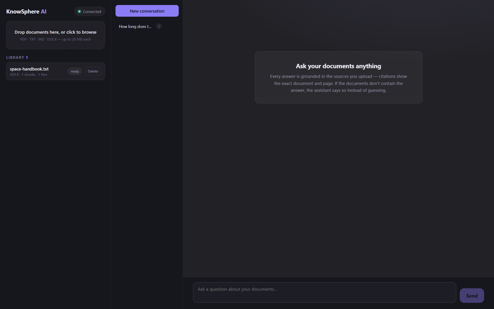
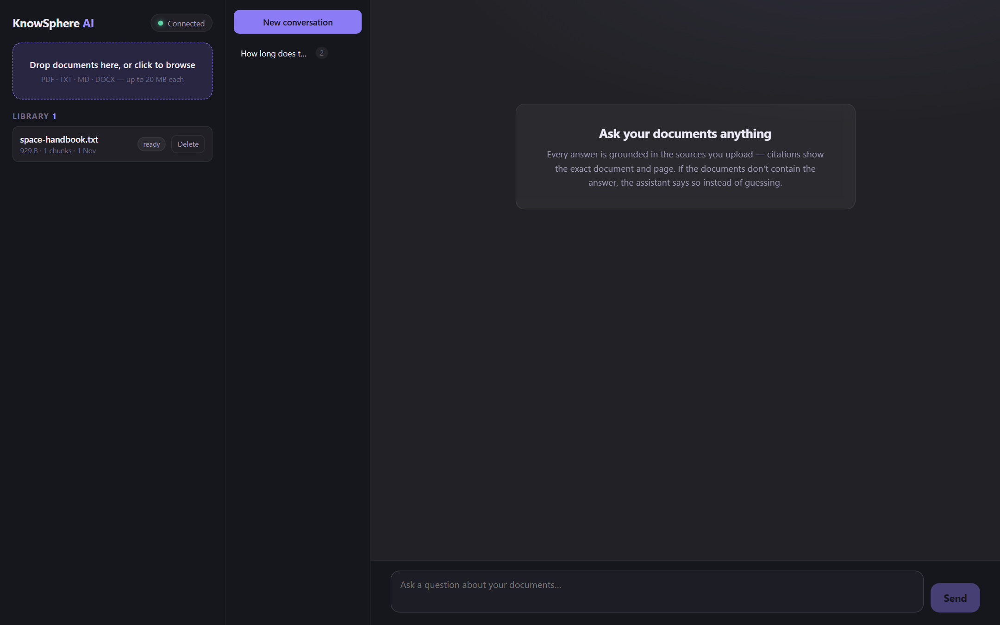
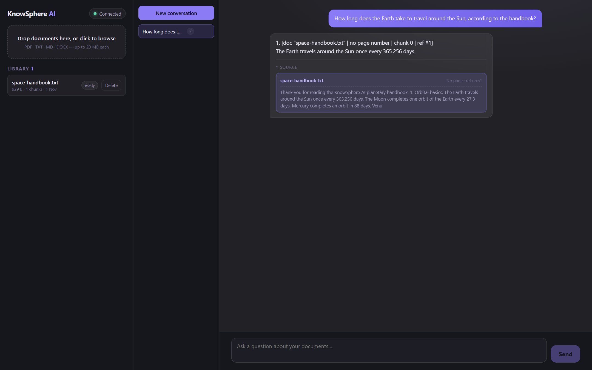
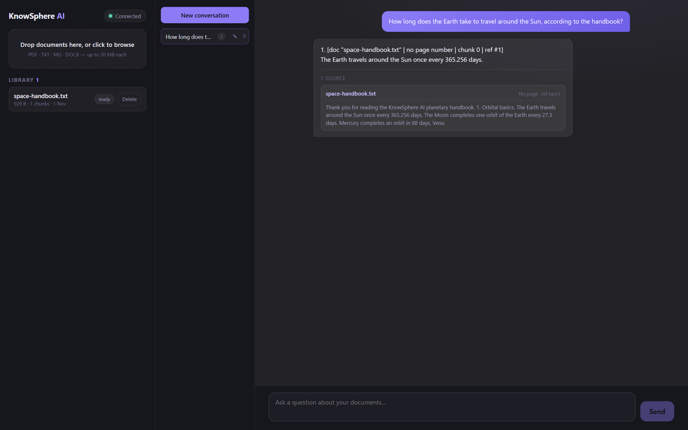
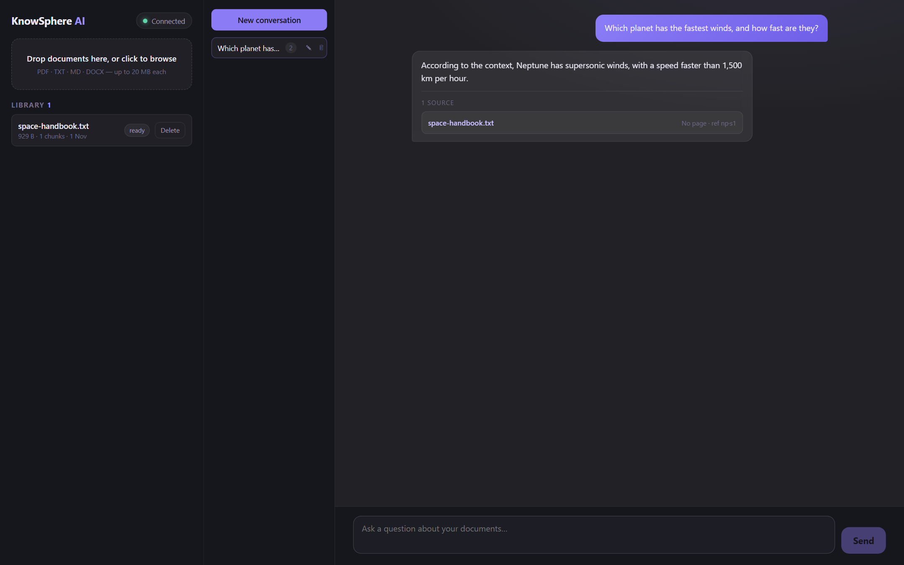

# KnowSphere AI

Chat with your own documents, locally. KnowSphere AI ingests PDFs, TXT, Markdown
and DOCX files, indexes them into a local vector store (ChromaDB), and answers
your questions with an LLM — grounded in retrieved passages, streamed token by
token, with clickable source citations (document name + page + chunk reference).

The **default workflow is 100% local and key-free**: embeddings run on CPU via
`sentence-transformers`, inference runs locally via [Ollama](https://ollama.com),
and all storage is a single SQLite file plus on-disk vectors. An optional
[OpenRouter](https://openrouter.ai) adapter unlocks cloud models (including
eligible `:free` models) without code changes.

---

## Features

- 📄 **Document ingestion** — drag & drop upload (PDF·TXT·MD·DOCX, ≤ 20 MB) with
  per-file progress, validation errors and duplicate detection; Word-boundary
  chunking with overlap; page numbers preserved for PDFs.
- 💬 **Streaming RAG chat** — questions retrieve the top-k most similar chunks
  (configurable k and similarity floor), build a grounded prompt, and stream the
  answer over Server-Sent Events. When the documents don't contain the answer,
  the assistant says so instead of guessing — citations are never fabricated.
- 🔎 **Citations** — every answer carries `meta` citations up front (name, page,
  chunk reference, snippet); rendered as expandable source cards.
- 🗂 **Conversations** — rename and delete conversations (with confirmation),
  history persisted in SQLite; previous turns are included in later prompts.
- 🔐 **Prompt-injection defense** — retrieved document text is treated as
  untrusted data inside `<context>` delimiters; instructions inside documents
  are never followed.
- 🌐 **Provider-agnostic LLM layer** — one `LLMProvider` interface with Ollama
  (default, local, key-free) and OpenRouter (optional) adapters; embeddings
  behind a separate `Embedder` interface.
- 🖥 **Two run modes** — Vite dev server (default) or FastAPI serving the built
  frontend from `frontend/dist` (opt-in).

## Technology stack

| Layer | Choice |
|-------|--------|
| Backend | Python 3.11 (3.10+ supported), FastAPI, pydantic-settings, Uvicorn, stdlib `sqlite3` |
| LLM | Ollama (default) · OpenRouter (optional, free-tier models supported) |
| Embeddings | sentence-transformers `all-MiniLM-L6-v2`, CPU by default |
| Vector store | ChromaDB (persistent, local, telemetry disabled) |
| Frontend | React 19 + TypeScript (strict) + Vite 6, vitest + Testing Library |
| Tests | pytest (offline via fake providers) · vitest · `tsc --noEmit` + `vite build` |

## Architecture overview

```
 Frontend (React + Vite)
        │  HTTP / SSE  ──►  Backend (FastAPI)
        │                        │
        │            ┌───────────┴────────────┐
        │            │   RAG pipeline         │
        │            │ ingest → embed → index │
        │            │ query → retrieve → LLM │
        │            └───────────┬────────────┘
        │                        │
        │   Provider-agnostic interfaces:
        │     LLMProvider → Ollama | OpenRouter | (future: …)
        │     Embedder    → sentence-transformers (all-MiniLM-L6-v2, CPU)
        │                        │
        └──────► Storage: ChromaDB (data/chroma) + SQLite (data/knowsphere.db)
                 + raw uploads (data/uploads)
```

Everything crosses clean boundaries: routing → pipeline → `Retriever`
(Embedder + Chroma) → `LLMProvider` (streaming) → SQLite history. No SDK
wrappers in the LLM adapters — plain HTTP with `httpx`.

## Project structure

```
knowsphere-ai/
├── backend/
│   ├── app/
│   │   ├── main.py                # FastAPI app factory, CORS, lifespan, optional SPA mount
│   │   ├── config.py              # Settings from .env, storage paths
│   │   ├── static.py              # opt-in production frontend serving (M6)
│   │   ├── api/                   # routers: health, documents, chat/conversations
│   │   ├── core/
│   │   │   ├── llm/               # LLMProvider protocol + Ollama/OpenRouter/fake adapters
│   │   │   ├── embeddings/        # Embedder protocol + sentence-transformers/fake adapters
│   │   │   └── retrieval/         # Chroma wrapper + query Retriever
│   │   ├── rag_pipeline.py        # retrieval → prompt → SSE stream → persistence
│   │   ├── ingestion/             # parse → chunk → embed → index (documents)
│   │   ├── db/                    # SQLite repositories (documents, conversations)
│   │   └── prompts/               # versioned prompt templates (txt files)
│   ├── tests/                     # pytest suite (147 tests: 146 active + 1 opt-in smoke)
│   ├── requirements.txt
│   └── requirements-ml.txt        # chromadb, pymupdf, python-docx, sentence-transformers
├── frontend/
│   ├── src/
│   │   ├── api/                   # typed client (ALL network I/O) + SSE parser
│   │   ├── hooks/                 # health/documents/chat state machines
│   │   ├── components/            # uploader, library, chat, source cards, dialogs
│   │   └── test/                  # vitest suites (66 tests)
│   └── vite.config.ts             # dev proxy: /api → http://127.0.0.1:8000
├── data/                          # gitignored runtime data (created on boot)
├── .env.example
└── README.md
```

## Prerequisites

- **Python 3.10+** (tested on 3.11.9) — [python.org](https://www.python.org/downloads/windows/)
  (check *Add to PATH* during install).
- **Node.js 18+** (tested on 24.x) — [nodejs.org](https://nodejs.org/).
- **Ollama** (for the default local LLM) — [ollama.com/download](https://ollama.com/download).
- Optional: an OpenRouter API key (cloud models). Free/local setup needs **no keys**.

> Windows 11 note: if the PowerShell execution policy blocks `npm.ps1` /
> `Activate.ps1`, use the explicit executables shown below (`npm.cmd`,
> `.venv\Scripts\python.exe`) — no policy changes required.

---

## Installation & setup (Windows 11)

```bat
git clone <your-repo-url> knowsphere-ai     :: or just download the folder
cd knowsphere-ai
copy .env.example .env
```

`.env` defaults work out of the box with Ollama. OpenRouter stays optional.

### 1. Backend

```bat
cd backend
python -m venv .venv
.venv\Scripts\python.exe -m pip install -r requirements.txt
.venv\Scripts\python.exe -m pip install -r requirements-ml.txt   :: parsers, ChromaDB, torch (CPU)
```

### 2. Ollama (default local LLM)

```bat
ollama pull llama3.1:8b      :: default model (~4.7 GB download, ~5 GB RAM in use)
ollama list
ollama serve                 :: if not already running as a service
```

`OLLAMA_CHAT_MODEL` in `.env` selects the model (any instruct model works,
e.g. `mistral:7b`, `llama3.2:3b` for smaller machines).

### 3. Frontend (development — recommended daily mode)

```bat
cd frontend
npm.cmd install
npm.cmd run dev
```

Open <http://localhost:5173>. The Vite dev server proxies `/api/*` to the
backend on port 8000, so backend and frontend run side by side and hot-reload.

### How to run locally (dev, two terminals)

```bat
:: terminal 1 — backend
cd backend
.venv\Scripts\python.exe -m uvicorn app.main:app --reload --port 8000

:: terminal 2 — frontend
cd frontend
npm.cmd run dev
```

Verify the backend directly: <http://127.0.0.1:8000/api/health>.

### How to run tests

```bat
:: backend (fully offline — fake providers, no Ollama/model needed)
cd backend
.venv\Scripts\python.exe -m pytest -v

:: frontend (vitest; strict types + production build)
cd frontend
npm.cmd run test        :: unit tests
npm.cmd run build       :: tsc --noEmit + vite build
```

> One test is skipped by default (`KNOWSPHERE_EMBED_SMOKE=1` opts in): it loads
> the *real* sentence-transformers model and downloads it on first run.

---

## Production mode (optional)

FastAPI can serve the built React app itself — one process, one port:

```bat
cd frontend && npm.cmd run build         :: produces frontend/dist
set SERVE_FRONTEND=1                     :: (.env: SERVE_FRONTEND=1)
cd ..\backend
.venv\Scripts\python.exe -m uvicorn app.main:app --port 8000
```

Now <http://127.0.0.1:8000/> serves the app: `/api/*` routes stay fully
separate; unknown paths serve `index.html` (React client-side routing);
missing *assets* (e.g. stale `/assets/*.js` from an old hash) return a proper
404 JSON instead of HTML. The Vite dev workflow is unchanged whether or not
this flag is on. Set `SERVE_FRONTEND=0` (or omit it) to restore API-only mode.

## Supported document formats

| Type | Notes |
|------|-------|
| PDF (`.pdf`) | text extraction with per-page tracking (pymupdf); scanned/image-only PDFs are not OCR'd |
| Plain text (`.txt`) | UTF-8 preferred |
| Markdown (`.md`) | parsed as text (rendering is left to the model) |
| Word (`.docx`) | paragraph text (python-docx) |
| Size limit | 20 MB per file (`MAX_UPLOAD_BYTES`) |

## Environment variables

Copy `.env.example` → `.env` and edit. All defaults are local & key-free.

| Variable | Default | Purpose |
|----------|---------|---------|
| `LLM_PROVIDER` | `ollama` | `ollama` · `openrouter` · (`fake` for tests) |
| `OLLAMA_BASE_URL` | `http://localhost:11434` | Ollama API endpoint |
| `OLLAMA_CHAT_MODEL` | `llama3.1:8b` | Ollama model tag |
| `OPENROUTER_API_KEY` | *(empty)* | required only when `LLM_PROVIDER=openrouter` |
| `OPENROUTER_CHAT_MODEL` | `meta-llama/llama-3.3-70b-instruct:free` | OpenRouter model id |
| `EMBEDDING_PROVIDER` | `sentence-transformers` | or `fake` (offline tests) |
| `EMBEDDING_MODEL` | `sentence-transformers/all-MiniLM-L6-v2` | local CPU embedding model |
| `EMBEDDING_DEVICE` | `cpu` | `cpu` recommended on 16 GB RAM |
| `DATA_DIR` | `data` | runtime storage root (SQLite, Chroma, uploads) |
| `MAX_UPLOAD_BYTES` | `20971520` | 20 MB upload cap |
| `CHUNK_MAX_CHARS` / `CHUNK_OVERLAP_CHARS` | `1000` / `200` | chunking shape |
| `RETRIEVAL_TOP_K` | `5` | chunks fetched per question (per-request override 1–20) |
| `MIN_SIMILARITY` | `0.30` | cosine-similarity floor; lower = more permissive |
| `CHAT_HISTORY_MESSAGES` | `8` | recent turns included in prompts |
| `SERVE_FRONTEND` | `0` | `1` = backend serves `frontend/dist` (production mode) |
| `FRONTEND_DIST_DIR` | `frontend/dist` | build output location (relative to the project root) |
| `CORS_ORIGINS` | `http://localhost:5173` | comma-separated allowed origins |

Secrets: `OPENROUTER_API_KEY` is read from the environment / `.env` only — it is
never sent to, or embedded in, the frontend (the browser only ever talks to
`/api/*` through the same-origin proxy).

### Optional cloud configuration (OpenRouter)

```env
LLM_PROVIDER=openrouter
OPENROUTER_API_KEY=sk-or-v1-…your-key…
```

Switch back to fully-local with `LLM_PROVIDER=ollama` (no key needed).

---

## Screenshots

All captures below are real screenshots of the running application
(Windows 11, Chromium via the DevTools Protocol against the production build
served by FastAPI; sample document: `space-handbook.txt`, local model:
`llama3.2:1b`). See [`docs/screenshots/capture.md`](docs/screenshots/capture.md)
for exactly how they were produced.


*Main dashboard — document library with the ingested handbook (`ready`),
drag & drop upload zone, conversation sidebar and the live `Connected`
health badge.*


*Upload dropzone (PDF · TXT · MD · DOCX, ≤ 20 MB) with library status and
delete control. The dropzone highlights on hover; uploads show per-file
progress, validation errors and duplicate detection.*


*Grounded answer streamed from the uploaded handbook. The answer cites
`[doc "space-handbook.txt" | chunk 0 | ref #1]` and the source card below is
expanded to show the retrieved snippet the answer was built from.*


*Conversation sidebar — hovering a conversation reveals the inline rename
(pencil) and delete (trash) controls; delete opens a confirmation dialog
before anything is removed.*


*Production mode — FastAPI serving the built React app from `frontend/dist`
(`SERVE_FRONTEND=1`) on a single port: `/api/*` and the SPA share one origin,
and the conversation above was re-opened after a full page reload to show
SQLite-persisted history.*

---

## Dependency & security notes

### The esbuild `allow-scripts` warning

`npm install` on recent Node prints:

```
npm warn install-scripts 1 package has install scripts not yet covered by allowScripts:
  esbuild@0.25.12 (postinstall: node install.js)
```

What this is: esbuild's `postinstall` validates the CPU/OS and wires up the
prebuilt binary from its platform package (`@esbuild/win32-x64` on Windows 11).
We **reviewed** the script (`frontend/node_modules/esbuild/install.js`) — it is
the upstream, no-network installer that only copies an already-downloaded
optional dependency.

Safe procedure on this project:

1. Leave the warning as-is — the project builds without running the script
   (verified; the binary package is installed as an npm optional dependency).
2. If you want a warning-free install, review the script yourself
   (`node_modules/esbuild/install.js`) and then approve that single package
   deliberately — never blanket-approve:
   ```bat
   npm.cmd install-scripts approve esbuild
   ```

### Git exclusion of sensitive files

`.gitignore` excludes: `backend/.venv/`, `frontend/node_modules/`,
`frontend/dist/`, `data/` (SQLite + ChromaDB + uploaded documents), `.env*`
(allow-listing `.env.example` only), caches and editor noise. Local
sentence-transformers model caches live in the user profile
(`%USERPROFILE%\.cache\huggingface`), outside the repository entirely.

### Secret audit (M6)

- No real API keys anywhere in the tree — only empty placeholders and two
  intentional dummy keys in offline tests (`sk-offline-test`, `sk-test-offline`).
- `.env` is not present in a fresh clone and never committed; if you create it
  locally it is already ignored.
- The frontend bundle contains no credentials; `grep` across `src/` confirms no
  key material is logged or embedded.

### Docker decision — skipped (deliberately)

Docker Compose was evaluated and **not** implemented. Honest reasons:

- The native Windows 11 setup already works end-to-end with a venv, and
  `requirements-ml.txt` (torch/chroma) installs cleanly; containers would add
  a ≥ 2 GB image (torch CPU) for zero functional gain.
- Ollama must run on the *host* (GPU access + the big model lives there), so a
  containerized backend would still need host networking juggling inside a
  Docker Desktop/WSL2 stack.
- Volume mounts of `data/` from Windows filesystems through WSL2 are
  noticeably slower for SQLite + Chroma persist operations.

If you later want it: it would be a small `backend`-only compose file with
`./data` bind-mounted for persistence and `SERVE_FRONTEND=1` — nothing in the
code would change. Native remains the documented path.

## Roadmap

| Milestone | Scope | Status |
|-----------|-------|--------|
| M1 | Project scaffold, config, `/api/health`, front-end shell, tests | ✅ |
| M2 | `LLMProvider`/`Embedder` interfaces · Ollama & OpenRouter adapters · fake providers for tests | ✅ |
| M3 | Document ingestion → chunking → ChromaDB indexing · SQLite metadata | ✅ |
| M4 | Streaming RAG `/api/chat` endpoint with citations | ✅ |
| M5 | Chat UI: uploader, streaming bubbles, source cards | ✅ |
| M6 | Conversation rename/delete · production serving · hardening & docs | ✅ |

## Current limitations & known issues

- **Quality depends on the model and corpus.** Answers are grounded in retrieved
  chunks, but the LLM (local 8B-class) can still phrase or summarize imperfectly;
  citations point to the retrieved evidence, not guaranteed verbatim quotes.
- **No OCR** — image-only PDFs yield no text and, correctly, no citations.
- **Embedding model is English-centric** (`all-MiniLM-L6-v2`); other languages
  retrieve with reduced accuracy.
- **Top-k similarity floor** is a fixed cosine threshold per request (0–1).
  No hyde/rerank; consider `MIN_SIMILARITY=0` for small corpora.
- **Single concurrent user assumption** — SQLite + per-process ingestor; there
  is no auth. Suitable for personal/local use only. Not hardened for hostile
  multi-user deployments (though prompt-injection defenses are in place).
- **First upload loads the model** — embedding model download (~90 MB) happens
  on first ingestion with the real provider (offline in tests).
- **Scanned frontends**: production serving is plain FileResponse over Uvicorn —
  fine for the intended single-user LAN/local use; put it behind a real web
  server/proxy if you expose it.

### Troubleshooting

| Symptom | Fix |
|---------|-----|
| Connection badge “Offline” | Backend not running — start uvicorn (port 8000). |
| Chat error `provider_unavailable` | Ollama not running (`ollama serve`) or wrong `OLLAMA_BASE_URL`. |
| Chat error `provider_not_configured` | `LLM_PROVIDER=openrouter` with an empty `OPENROUTER_API_KEY`. |
| First upload is slow | Embedding model download (~90 MB) on first use — subsequent uploads are fast. |
| `Upload failed 409` | Same filename already ingested (dedupe); rename the file. |
| `Upload failed 415` | Unsupported file type (allowed: PDF/TXT/MD/DOCX). |
| PowerShell blocks npm/python scripts | Use `npm.cmd` and `.venv\Scripts\python.exe` directly. |
| `npm install` shows esbuild warning | See “Dependency & security notes” above — safe to leave, or approve after review. |
| Port 8000/5173 already in use | Change `--port` / Vite will pick 5174 (update `CORS_ORIGINS` if needed). |

## Resource notes (16 GB RAM target)

- `all-MiniLM-L6-v2` on CPU ≈ 90 MB model footprint — comfortable.
- A 7–8B Q4 model in Ollama needs ~5–7 GB; keep browser tabs modest while
  chatting. Prefer `llama3.2:3b` on tighter budgets.
- Embedding batches are kept small (M3) to respect the CPU/memory budget.

**Status disclaimer:** runs its full offline test suite green and is verified
with live local smoke runs (dev + production mode), but it has *not* been audited
or load-tested — treat it as local personal software, not a
deployed production service.
